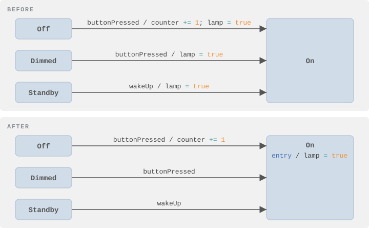
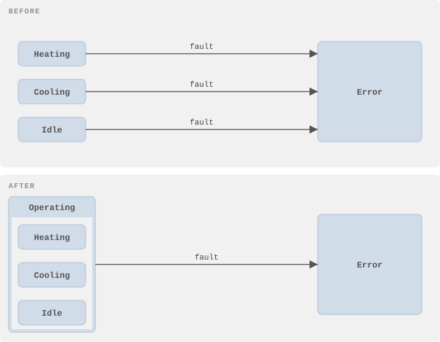
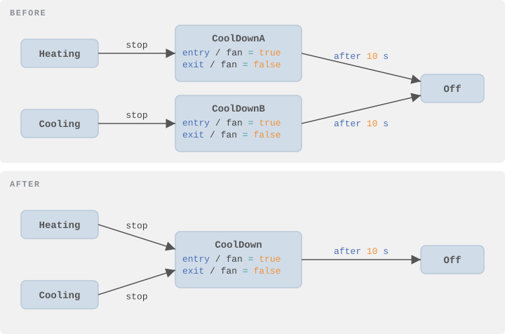

Statecharts rarely stay the way you first drew them. Requirements change, states get added, and after a while the diagram that once fit on a napkin looks like a plate of spaghetti. The behavior is still right — but nobody wants to touch it anymore.

That's the moment for **refactoring**: improving the structure of a model without changing what it does.

In this chapter, you'll learn:

- What **refactoring** means for statecharts
- How to recognize typical **model smells**
- Which **refactoring** fixes which smell
- What can go wrong, and how to **refactor safely**

---

## What Is Refactoring?

In programming, refactoring means changing the structure of code without changing its behavior: rename a variable, extract a method, remove duplication. The same idea works for statecharts.

A **model smell** is the statechart version of a code smell. Nothing is broken, but something is harder to read or change than it should be. For each smell, there is usually a refactoring that removes it — and often a reverse refactoring that undoes it when you need more freedom again.

The important word is *behavior*. A refactoring is only a refactoring if the statechart reacts to every event exactly as before.

---

## Smell: The Same Action on Many Transitions

Imagine several transitions lead into the same state, and each of them ends with the same action, here `lamp = true`. Add a fourth transition and forget it, and you have a bug.

**Refactoring: Fold Incoming Actions.** Move the common action into the **entry action** of the target state:



The mirror image is **Fold Outgoing Actions**: an action that starts every outgoing transition moves into the **exit action** of the state.

This looks trivial, but there are three rules:

- The action must be on **all** incoming transitions, not just most of them
- It must be the **last** action on each transition, because entry actions run *after* transition actions (see [Chapter 2](02-states-transitions-and-events.html))
- If a transition crosses into a composite state that has its own entry action, that action would now run in between — so the order changes

Here is the second rule in action:

```text
A → Target :  ev / x += 1; y += 42
B → Target :  ev / x += 1; y = x; y += 42
```

Only `y += 42` can move to the entry action. `x += 1` appears on both transitions too, but if you moved it, `y = x` would run before the increment.

The reverse refactorings are **Unfold Entry Actions** and **Unfold Exit Actions**. Use them when one transition suddenly needs to behave differently from the others.

---

## Smell: The Same Transition from Many States

Every state has a transition to `Error`. Every state reacts to `cancel` in the same way. The diagram turns into a spider web.

**Refactoring: Group States.** Put the states into a new **composite state** and replace the identical transitions with a single one that leaves the composite:



This is exactly what composite states were made for (see [Chapter 4](04-composite-states.html)). The states must sit in the same region, and the transitions must really be identical: same event, same guard, same action, same target.

The reverse is **Unfold Outgoing Transitions**: replace the one transition of the composite state with one per substate. That's the first step when a single substate needs to handle the event differently.

---

## Smell: States That Are Twins

Two states have the same actions and the same outgoing transitions. They often appear after a long series of changes, or when someone copied a state "just to be safe".

**Refactoring: Merge States.** Combine the two states into one and redirect all incoming transitions.



After a merge, you may find a transition that leads from the new state back to itself. If it does nothing, you can remove it — but be careful: a self-transition leaves and re-enters the state. If the state has entry or exit actions, or a timed trigger like `after 5 s`, the self-transition is doing something after all.

A close relative of this smell is **states that count**: `Pressed1`, `Pressed2`, `Pressed3`. Replace them with one state and a variable, as shown in [Chapter 3](03-variables.html).

---

## Smell: Transitions That Do Too Much

A transition label that fills three lines is hard to read and impossible to reuse.

- **Long action lists**: move the actions into a single, well-named operation. `start / prepareTransmission()` says more than six assignments.
- **Decisions hidden in actions**: if an action contains an if/else, the statechart is hiding a branch. Replace it with two transitions with different guards, or with a choice node (see [Chapter 6](06-final-states-choices-and-history.html)). Now the decision is visible in the diagram.
- **Flags that mirror states**: a boolean like `isHeating` that is always true in exactly one state is redundant. Ask for the state instead, or model the aspect in its own region.

---

## Smell: The Diagram That Doesn't Fit on a Screen

When a statechart grows beyond what you can take in at a glance, you have two options.

**Refactoring: Extract Subdiagram.** Move the contents of a composite state into a diagram of its own. The model stays one state machine; only the picture is split. This is the safe option, because the behavior cannot change.

**Refactoring: Extract Statechart.** Move a part of the model — typically a region that runs in parallel to the rest — into a **separate state machine**. This is a much bigger step:

- Events that were visible everywhere must now be **sent explicitly** from one machine to the other
- If the extracted part was not a whole region, a placeholder state stays behind, and the new machine needs an idle state and an event that activates it
- Variables used on both sides must be passed across

And there is a trap. Inside one statechart, the order in which things happen is well defined. Between two machines that exchange messages, it may not be. Suppose one event used to trigger "activate the sub-behavior" and "send it `v`" in a fixed order. After extraction these are two messages. If `v` arrives first, the new machine is still idle and ignores it — and ends up in a state the original statechart could never reach.

> 💡 **Tip:** After extracting a state machine, test the event sequences that cross the new boundary. This is where behavior changes silently.

---

## Smells and Refactorings at a Glance

| Smell | Refactoring | Reverse |
|---|---|---|
| Same action at the end of all incoming transitions | Fold Incoming Actions | Unfold Entry Actions |
| Same action at the start of all outgoing transitions | Fold Outgoing Actions | Unfold Exit Actions |
| Same transition from many states | Group States | Unfold Outgoing Transitions |
| Two states with identical behavior | Merge States | Split State |
| States that only count | Replace with a variable | — |
| Long action list on a transition | Extract into an operation | Inline the operation |
| If/else inside an action | Split into guarded transitions | — |
| Diagram too large | Extract Subdiagram | Inline Subdiagram |
| Independent behavior inside one machine | Extract Statechart | — |
| Names like `State1` or `ev2` | Rename | — |

---

## Refactor Safely

A refactoring that changes behavior is just a bug with a nice name. A few habits keep you safe:

- **Have tests first.** The tests from [Chapter 10](10-testing-state-machines.html) tell you immediately whether the behavior changed
- **Take small steps.** One refactoring, run the tests, then the next
- **Watch the order.** Exit actions, transition actions, and entry actions run in a fixed sequence; most refactoring mistakes change that sequence
- **Let the tool do it.** Automated refactorings check the preconditions for you and refuse when the behavior would change

Tool support varies. itemis CREATE, for example, automates folding and unfolding of entry and exit actions, grouping states into a composite state, and extracting and inlining subdiagrams, each with the precondition checks described above. The details are in the [refactoring section of its documentation](https://www.itemis.com/en/products/itemis-create/documentation/user-guide/create-for-eclipse/editing-statecharts/?utm_source=statecharts.online&utm_medium=referral&utm_campaign=state-machine-guide&utm_content=ch11-refactoring#edit_refactorings).

---

## Summary

Refactoring keeps a statechart readable while it grows:

- A **model smell** points to a structural problem, not a bug
- **Fold** repeated transition actions into entry and exit actions — but mind the execution order
- **Group** states that share transitions into a composite state
- **Merge** twin states and replace counting states with variables
- **Extract** large parts into subdiagrams, or into separate state machines when they are truly independent
- Always refactor with **tests** as your safety net

Many of the refactorings in this chapter were first cataloged in research on UML and statechart refactoring, notably *Refactoring UML Models* by Sunyé, Pollet, Le Traon, and Jézéquel (2001) and *Refactoring of Statecharts* by Abadi and Feldman (2009). Both are worth reading if you want the formal background.

---



---

<div style="display: flex; justify-content: space-between; width: 100%; align-items: center;">
  <div style="text-align: left; flex: 2;"><a href="10-testing-state-machines.html">← Previous: Testing State Machines</a></div>
  <div style="text-align: center; flex: 1;"><a href="#top">Back to top</a></div>
  <div style="text-align: right; flex: 2;"><a href="12-summary-and-next-steps.html">Next: Summary and Next Steps →</a></div>
</div>
